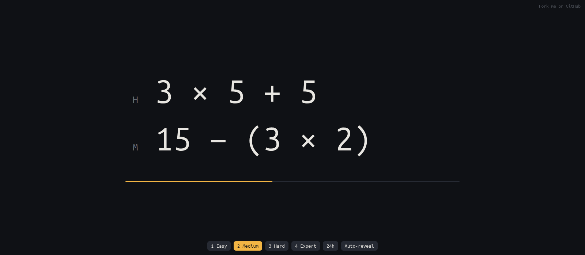
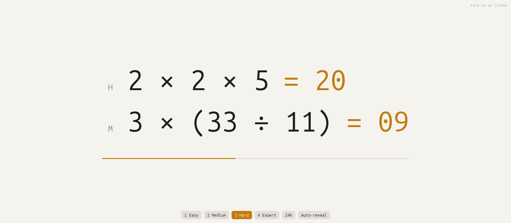

# Math Clock

Math Clock turns the current time into two arithmetic riddles: one for the hour and one for the minute. Difficulty, 12-hour mode, automatic answer reveal, and a shared riddle salt can be set in the controls or with URL parameters.

## Browser Site

Open `web/index.html` directly or serve the `web/` directory with any static web server. The page has no build step or runtime dependencies.





### Difficulty levels

| Level | Name   | Riddle                                                     |
| ----- | ------ | ---------------------------------------------------------- |
| 1     | Easy   | One `+` or `−`                                             |
| 2     | Medium | Two operations, including at least one `×`                 |
| 3     | Hard   | Two or three operations with `×` and `÷`, may use brackets |
| 4     | Expert | Three operations with `×` and `÷`, may use brackets        |

Every number in a riddle, and every intermediate result, stays between 0 and 99. Riddles are deterministic: the same date, level, 12/24-hour mode and salt always produce the same riddles.

### URL parameters

URL parameters override settings saved in the browser (`localStorage`), for example `web/index.html?level=3&h12=1&widget=1`.

| Parameter | Values     | Default | Effect                                                         |
| --------- | ---------- | ------- | -------------------------------------------------------------- |
| `level`   | `1`–`4`    | `2`     | Difficulty                                                     |
| `h12`     | `0`, `1`   | `0`     | 12-hour clock                                                  |
| `auto`    | `0`, `1`   | `1`     | Reveal the answers during the last 10 seconds of each minute   |
| `salt`    | any string | empty   | Same salt gives the same riddles on every device               |
| `widget`  | `1`        | off     | Transparent page background, for embedding as a desktop widget |

### Controls

- Click anywhere or press `Space` to show or hide the answers.
- Press `1`–`4` to change the difficulty and `t` to toggle 12/24-hour mode.
- Move the mouse to show the on-screen buttons for the same settings and auto-reveal. They hide after 3 seconds.

### Files

- `web/`: the static site (`index.html` and `riddle.js`). `riddle.js` is a plain script usable from a browser (`MathClock` global) and Node (`require`).
- `artifact/mathclock.html`: a variant of the page for publishing as a claude.ai artifact. It loads `riddle.js` from its own directory, so publish `web/riddle.js` next to it. It has no URL parameters.
- `gnome-extension/`: the GNOME Shell extension, described below.
- `test.js`: the riddle-generator check.

## Development

Requires Node.js only for the tests. Run the exhaustive riddle-generator check, which covers every value from 0 to 59 at every level with many seeds and exits non-zero on failure:

```sh
node test.js
```

Code style is defined by `.prettierrc`. Check formatting and lint with:

```sh
npx prettier --check .
npx eslint .
```

The repository does not pin these tools. ESLint needs a flat config that treats `web/riddle.js` and `test.js` as CommonJS, and the extension sources and `gnome-extension/test/*.mjs` as ES modules.

## GNOME Shell Extension

The extension in `gnome-extension/` targets GNOME Shell 50. Its README covers installation and development. Build and install it with:

```sh
cd gnome-extension
./build.sh --install
```

Build output (`gnome-extension/dist/` and the generated `gnome-extension/riddle.js`) is git-ignored. Run its mocked smoke test without GNOME Shell (run `./build.sh` first, since the test imports the generated `riddle.js`):

```sh
cd gnome-extension/test
node --import ./register.mjs smoke.mjs
```

## License

[MIT](LICENSE)
